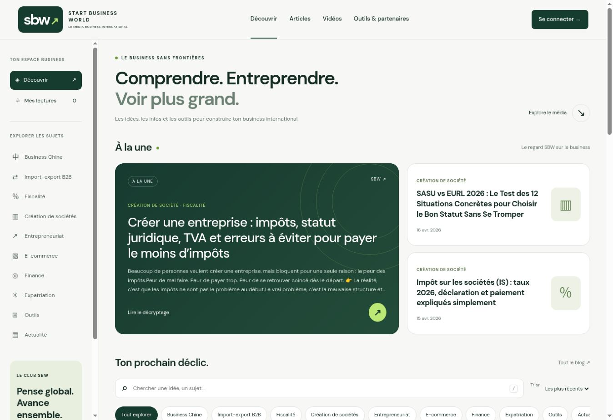
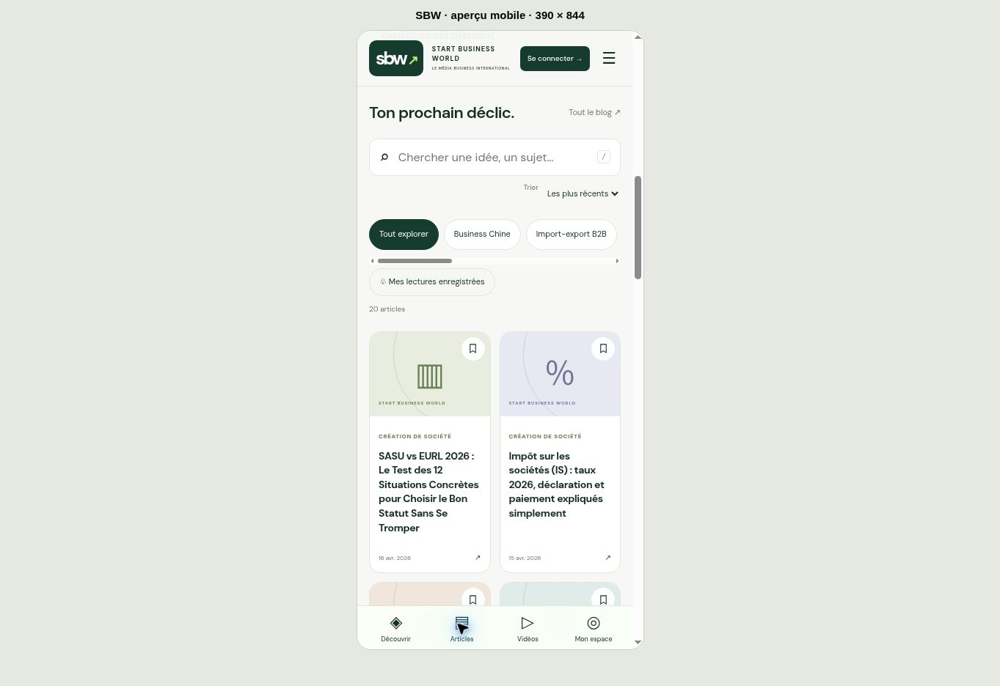

# Accueil média interactif — version de revue

Branche : `redesign/interactive-media-home`.
Base : `8c813677d1ba60b8c347c264fbf652b12cf47a43` (récupération du mot de passe administrateur).
Aucune fusion ni mise en production autorisée à ce stade.

## Essayer la version

Depuis une copie du dépôt :

```sh
git switch redesign/interactive-media-home
python3 -m http.server 8000
```

Ouvrir http://localhost:8000/ dans un navigateur. Une connexion Internet est nécessaire pour les contenus publiés Supabase, les polices et YouTube. Ne pas ouvrir le fichier directement via `file://`.

La page utilise le projet Supabase existant et sa clé publique existante. Articles et Shorts sont lus uniquement avec `status=published`. Les catégories et la recherche portent sur tous les articles récupérés par pages de 100, et non sur les neuf derniers. La catégorie historique « Création société » est regroupée avec « Création de société » sans modifier la base.

Les titres, résumés et dates proviennent de Supabase. Aucun article de démonstration, compteur d'audience, nombre de vues ou temps de lecture inventé. Les visuels abstraits sont décoratifs ; les vignettes vidéo viennent de YouTube. Les liens partenaires Luminos, Airwallex et Wise reprennent les destinations déjà présentes dans `article.html`.

Fonctions ajoutées : recherche sans distinction d'accents, filtres par catégorie avec URL partageable, tri chronologique, chargement progressif, lectures enregistrées localement, navigation mobile fixe, menu mobile, lecteur vidéo accessible via dialog natif et états de chargement/erreur avec relance.

Les favoris sont propres à l'appareil, sans synchronisation au compte. La newsletter reste reliée à `subscribers` avec `{email, source: 'index'}` : une soumission depuis l'aperçu normal crée une vraie inscription. Utiliser le banc de test ci-dessous pour la tester sans écriture. Le tracker existant reste actif sur les deux domaines de production ; il n'est pas chargé sur les aperçus locaux.

## Vérifications du 31 octobre 2026

- Lecture réelle : 20 articles publiés et 3 Shorts. Affichage des titres réels vérifié.
- Navigateur : filtre Business Chine (2 résultats), recherche Hong Kong (3 résultats), recherche vide, ajout aux lectures et persistance après rechargement, ouverture/fermeture du lecteur YouTube.
- Rendu ordinateur et cadre mobile 390 × 844 : cartes, menu, navigation basse, recherche ; largeur du contenu mobile 375 px avec barre de défilement, sans débordement horizontal.
- Banc de test isolé : 19/19 contrôles du parcours nominal ; 23/23 avec erreurs initiales et relance ; 2/2 pour une base sans publications. Réponses réseau simulées, aucun envoi newsletter réel. Les jeux de données TEST ONLY sont uniquement dans le générateur de tests, jamais chargés par l'accueil.
- Syntaxe JS validée avec `node --check`. IDs uniques, ancres valides, destinations locales présentes, aucun `href="#"`.
- `admin-login.html`, `admin-auth.js`, `auth-callback.html`, `client-login.html`, `client-dashboard.html`, `sbw-nav-auth.js` et `sbw-tracker.js` sont identiques octet par octet à la base. Aucune modification de schéma, RLS, secrets, fonctions Edge ou configuration d'authentification.

Limites : aucune connexion avec identifiants réels, aucun envoi d'email de récupération et aucune transaction de paiement effectués. La préservation des parcours privés est vérifiée par comparaison du code, pas par un parcours authentifié de bout en bout. L'affichage mobile a été vérifié dans Chromium, pas sur un iPhone physique. Le contenu éditorial existant n'a pas fait l'objet d'une revue fiscale.

## Rejouer les tests sans toucher à la production

```sh
python3 tests/build-home-harness.py
python3 -m http.server 8000
```

Ouvrir successivement :

- http://localhost:8000/tests/home-harness.html
- http://localhost:8000/tests/home-harness.html?scenario=error
- http://localhost:8000/tests/home-harness.html?scenario=empty

Le rapport PASS/FAIL s'affiche par-dessus la page. Le générateur retire les scripts Supabase, d'authentification et de suivi et remplace `fetch` par des réponses locales. Le HTML généré est ignoré par Git.

## Captures



